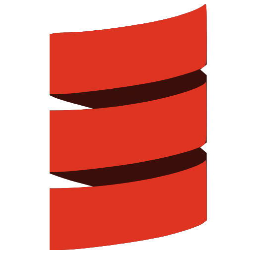

<!-- GitHub profile README for: https://github.com/navassherif98 -->
<!-- Keep the existing view counter and image assets in this repository. -->

  

<h1 align="center">
  Hi, I'm Navas Sherif
  
</h1>

<h3 align="center">Senior AI/ML Engineer · Agentic AI · MLOps · Backend & SDK Engineering</h3>

  Building practical, reliable AI systems for enterprise use cases.

  
  

---

### 👨‍💻 About me

I'm a **Senior AI/ML Engineer at Tiger Analytics**, with an engineering background spanning **data engineering, MLOps platforms, enterprise agentic AI, and backend/SDK development**.

My work has evolved from large-scale data pipelines and ML platform capabilities to building **agentic AI platform components, Python/FastAPI services, secure integrations, and reusable engineering foundations**. I've also had experience **leading a small engineering team**.

I'm interested in the next step of that journey: **Applied AI Engineering, Forward Deployed Engineering, and AI Solution Architecture** — connecting technical execution with system design and real business requirements.

### 🧭 Professional journey

| Role | Focus |
| --- | --- |
| **Senior AI/ML Engineer · Tiger Analytics** | Enterprise agentic AI, FastAPI backend services, authentication and authorization, reusable SDKs, integration patterns, and small-team leadership |
| **Machine Learning Engineer · Tiger Analytics** | MLOps platform engineering, data pipelines, cost analytics, and supporting ML lifecycle capabilities |
| **Associate Software Developer · IQVIA** | Healthcare data engineering, legacy-to-big-data modernization, Spark-based processing, ETL, and pipeline orchestration |

### 🛠️ Technologies & engineering focus

#### 🤖 Agentic AI & LLM engineering

  
  
  
  
  

#### ⚙️ Backend, APIs & integration

  
  
  
  
  

#### ☁️ Data, cloud & engineering tools

  
  
  
  
  
  
  
  

| Area | Technologies & capabilities |
| --- | --- |
| **Agentic AI / LLM tooling** | Agent workflows, LangChain, LangGraph, tool integration, MCP and RAG concepts *(hands-on depth varies)* |
| **Backend & integrations** | Python, FastAPI, REST APIs, SDK development, authentication, authorization, enterprise integration |
| **ML platform experience** | MLOps platforms, model lifecycle exposure, data and cost analytics pipelines |
| **Data engineering** | SQL, Scala, Apache Spark, PySpark, Apache Airflow, Hadoop, ETL and data pipelines |
| **Cloud & engineering tools** | Azure and Databricks experience; AWS/GCP exposure; Git and GitLab |

**Currently strengthening:** LLM evaluation, AI guardrails, observability, production deployment, cloud architecture, and customer-focused solution design.

### 🚀 Selected work

#### 🌐 Enterprise AI & platform engineering

- **Agentic AI platform engineering:** Backend functionality and secure integration capabilities for enterprise agent applications.
- **Reusable AI SDKs:** Common integration components and standardized approaches to support AI engineering teams.
- **ML platform engineering:** Data and cost analytics pipelines supporting MLOps-related operations.

> These are high-level summaries of professional experience, not links to public employer code.

#### 📂 Public GitHub project

**[Recipe Generation from Food Image](https://github.com/navassherif98/Recipe-Generation-from-Food-Image)**  
A deep-learning-based application exploring the generation of recipe details from food images. Includes a Python application and work using pretrained components.

➡️ **[Browse all public repositories](https://github.com/navassherif98?tab=repositories)**

#### 🔭 What I'm building toward

Personal AI engineering projects focused on **secure agent backends, LLM evaluation, observability, and deployable enterprise-style AI solutions**. These are learning and portfolio goals, not claims of completed public projects.

### 🏅 Certifications & learning

- [Databricks Certified Machine Learning Associate](https://credentials.databricks.com/4f020114-689b-4406-a156-1eae84fb4c82) · Sep 2025
- **Databricks Certified Data Engineer Professional** · Jun 2025
- **Azure Databricks & Spark for Data Engineers** (course) · Dec 2023
- [Microsoft Certified: Azure Data Fundamentals](https://www.credly.com/badges/0a2ecbdc-6393-4130-a6ca-c0cd7db01e61/public_url) · Jan 2023
- **IBM Data Science Professional Certificate** · Aug 2021

### 🤝 Let's connect

I'm interested in **enterprise AI engineering, applied AI systems, agentic architectures, and solution engineering**.

- 💼 [LinkedIn](https://www.linkedin.com/in/navassherif/)
- 💻 [GitHub](https://github.com/navassherif98)

---

<i>From data platforms to AI systems — always learning, building, and improving.</i>

